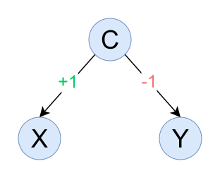

# Causal Search for Skylines (CSS): Causally-Informed Selective Data De-Correlation

This repository contains the implementation of Causal Search for Skylines (CSS), as described in our paper submitted to SIGMOD 2026.

## File Structure

### `/skylines/__init__.py`

Contains all configurations for the experiment setup.

### `/skylines/dataset/`

Contains all datasets used for experiments.

- `synthetic/`: Contains data sets for experiment with synthetic causal graphs; including the causal graphs, preference attribute sets, dominance criteria, and scripts to generate the synthetic data.
- `real/`: Contains data sets for experiments with real-world causal graphs; including the causal graphs, preference attributes sets, dominance criteria, and scripts to generate the (augmented) real-world data.
- `real/data/`: Contains raw unaugmented data files for real-world datasets in tabular CSV format, where rows represent tuples and columns represent variables.

### `/skylines/heuristic/`

Contains implementations of heuristics for finding best conditioning set.

- `algorithm0.py`: Contains implementation of the `ddSkyline` heuristic.
- `algorithm4.py`: Contains implementation of the `gnSkyline` heuristic.
- `algorithm4_leaky.py`: Contains implementation of the `lnSkyline` heuristic.

### `/skylines/skyline/`

Contains implementations naive and causal versions of all skyline algorithms using in our experimentation.

- `bnl/`: Implementation of naive and causal versions of Block Nested Loop (BNL) algorithm.
- `sfs/`: Implementation of naive and causal versions of Sort-Filter-Skyline (SFS) algorithm.
- `salsa/`: Implementation of naive and causal versions of Sort and Limit Skyline algorithm (SaLSa).
- `dnc/`: Implementation of naive and causal versions of Divide and Conquer (D&C) skyline algorithm.
- `bbs/`: Implementation of naive and causal versions of Branch and Bound Skyline (BBS) algorithm.

### `/skylines/experiment/core/`

Contains the core code for execution of the experiments.

- `benchmark.py`: Creates dataset instances based on the configuration and executes the skyline experiments.
- `summarize.py`: Summarize the executed skyline experiments for further analysis.
- `gain.py`: Creates dataset instances and compare the time required to execute `ddSkyline`, `gnSkyline`, and `lnSkyline`.

In all these experiments, `Gain 0` refers to `ddSkyline`, `Gain 4` refers to `gnSkyline`, and `Leaky Gain 4` refers to `lnSkyline`. The leakage parameters defined in `/skylines/__init__.py` will be used by `lnSkyline`.

### `/skylines/common/`

Contains definition of various common boilerplate code.

`/constants`: Defines constants used for the experiments including definition of all experiment sets.

`/kmeans`: Implementation of K-Means algorithm.

`/utils`: Defines various common utility methods.

## Causal Graphs

As mentioned before, datasets are defined inside `/skylines/dataset/`.

A typical dataset definition looks like the following:

    class XY_C_1(SyntheticDataset):

        def __init__(self,
                    dominance: dict[str, Dominance] = None,
                    size: int = 10000,
                    seed: int = 42):
            super().__init__(control=['C'],
                            preference=['X', 'Y'],
                            effect={'X': {'C':  1},
                                    'Y': {'C': -1}},
                            dominance=dominance,
                            infer_controls={
                                'X': Dominance.MAX,
                                'Y': Dominance.MAX
                            },
                            size=size,
                            seed=seed)

The causal graph is encoded using a weighted directed adjacency map, in the following block of code:

    effect={'X': {'C':  1},
            'Y': {'C': -1}},

What this specifies is variate `C` affects variate `X` with a causal strength of `+1`. Further, variate `C` also affects variate `Y` with a causal strength of `-1`.

A Directed Acyclic Graph (DAG) representation of this structure will be:



The causal graph of any dataset defined in our experiments can be interpreted in the same manner.

## Requirements

The experiments were run using Python 3.12.7 using a conda environment. The process to set up the environment is defined below.

> [!NOTE]
> If using Docker, skip the Miniconda installation and conda environment creation and activation steps below. Docker sets up the environment automatically.

### Installing Miniconda

Install miniconda from [https://www.anaconda.com/docs/getting-started/miniconda/install](https://www.anaconda.com/docs/getting-started/miniconda/install).

### Creating environment

Create the conda environment based on the provided `environment.yml` file using the following command:

    conda env create -f environment.yml

This will create a new conda environment name `skyline`.

### Activating conda environment

In order to use the `skyline` conda environment, activate it using the following command:

    conda activate skyline

## Experiment Setup

The `configs/` folder contains presets for the following experiments:

| Experiment             | Settings varied                                                | Location                                   |
| ---------------------- | -------------------------------------------------------------- | ------------------------------------------ |
| Method comparison      | ddSky, gnSky, lnSky, and preference de-correlation             | `configs/200K/`                          |
| Dataset size           | 50K, 100K, 200K, and 400K tuples                               | `configs/{size}/`                        |
| Leakage                | (0.6, 0.4), (0.7, 0.3), (0.8, 0.2), (0.9, 0.1), and (1.0, 0.0) | `configs/200K/lnSky {leakage}/`          |
| Cluster count          | 2–20 clusters                                                 | `configs/200K/clusters/{count}/`         |
| Causal graph inference | lnSky with NOTEARS-inferred causal graphs                      | `configs/200K/lnSky (0.6, 0.4) NOTEARS/` |

Each experiment includes four presets covering synthetic and real-world datasets with both `Z = P` and `Z != P`. All presets use five runs.

Unless varied, experiments use 200K tuples and 10 clusters. The dataset-size, cluster-count, and NOTEARS experiments use lnSky with leakage (0.6, 0.4).

For example, `configs/200K/ddSky/real (Z != P).py` configures skyline computation with ddSky on real-world datasets with `Z != P`, 200K tuples, 10 clusters, and five runs. Each preset begins with a short description of its setup.

To use a preset, copy it to `skylines/__init__.py` and follow the instructions below.

## Running Manually

### Run skyline computation experiments

These experiments execute skyline queries using both the non-causal version and causal version of the skyline algorithms, and reports both the number of dominance checks and execution time.

To run the experiment use the following command:

    python -m skylines.experiment.core.benchmark

To summarize the experiment results use the following command:

    python -m skylines.experiment.core.summarize

### Run gain computation experiments

These experiments report the time required to find the best possible conditioning attribute set based on the heuristics proposed in the paper.

To run the experiment use the following command:

    python -m skylines.experiment.core.gain

### Generate inferred causal graphs using NOTEARS

This script generates the inferred causal graphs using NOTEARS algorithm. It is manadatory to run this script to build the cache of causal graphs before using `infer_graph = True`.

To run the experiment use the following command:

    python -m skylines.experiment.core.graph

## Running with Docker

The Docker image sets up the `skyline` conda environment from `environment.yml` and runs the experiment configured in `skylines/__init__.py`.

> [!NOTE]
> The Docker image requires an x86 (`linux/amd64`) platform.

1. Copy a preset from `configs/` to `skylines/__init__.py` as described in [Experiment Setup](#experiment-setup). The file is mounted into the container at runtime, so no rebuild is needed after changing it.

2. Build the image:

    docker compose build

3. Run the experiment:

    docker compose run --rm css

Use the `MODE` variable to select what to run:

- `benchmark` (default): skyline computation experiments, followed by `summarize`
- `gain`: gain computation experiments
- `graph`: build the NOTEARS inferred causal graph cache
- `all`: `benchmark`, `summarize`, then `gain`

For example:

    MODE=gain docker compose run --rm css

> [!NOTE]
> `benchmark`, `graph` and `gain` each start a new timestamped output directory, and `summarize` reads the latest one. Therefore `summarize` must run right after `benchmark`; the `benchmark` and `all` modes keep this order. If you run `MODE=gain` (or `MODE=graph`) and then try to summarize later, `summarize` will point at the gain (or graph) run instead of the benchmark run.

If `infer_graph = True` and no causal graph cache exists yet, the graph cache is built automatically before the experiment.

The number of BLAS/OpenMP threads defaults to 64 (as in `openblas.sh`) and can be changed with `N_THREADS`, e.g. `N_THREADS=32 docker compose run --rm css`.

All outputs (`out/`, `graphs/`, `timestamp.txt`) are written to `./results` on the host.

## Citation

If you use this work, please cite our paper:

**Causal Search for Skylines (CSS): Causally-Informed Selective Data De-Correlation**
Pratanu Mandal, Abhinav Gorantla, K. Selçuk Candan, Maria Luisa Sapino
*Accepted to SIGMOD 2026 · [https://dl.acm.org/doi/10.1145/3802026](https://dl.acm.org/doi/10.1145/3802026)*

```bibtex
@article{10.1145/3802026,
author = {Mandal, Pratanu and Gorantla, Abhinav and Candan, K. Sel\c{c}uk and Sapino, Maria Luisa},
title = {Causal Search for Skylines (CSS): Causally-Informed Selective Data De-Correlation},
year = {2026},
issue_date = {June 2026},
publisher = {Association for Computing Machinery},
address = {New York, NY, USA},
volume = {4},
number = {3},
url = {https://doi.org/10.1145/3802026},
doi = {10.1145/3802026},
abstract = {Skyline queries are popular and effective tools in multi-criteria decision support as they extract interesting (pareto-optimal) points that help summarize the available data with respect to a given set of preference attributes. Unfortunately, the efficiency of the skyline algorithms depends heavily on the underlying data statistics. In this paper, we argue that the efficiency of the skyline algorithms could be significantly boosted if one could erase any attribute correlations that do not agree with the preference criteria, while preserving (or even boosting) correlations that agree with the user provided criteria. Therefore, we propose a causally-informed selective de-correlation mechanism to enable skyline algorithms to better leverage the pruning opportunities provided by the positively-aligned data distributions, without having to suffer from the mis-alignments. In particular, we show that, given a causal graph that describes the underlying causal structure of the data, one can identify a subset of the attributes that can be used to selectively de-correlate the preference attributes. Importantly, the proposed causal search for skylines (CSS) approach is agnostic to the underlying candidate enumeration and pruning strategies and, therefore, can be leveraged to improve any popular skyline discovery algorithm. Experiments on multiple real and synthetic data sets and for different skyline discovery algorithms show that the proposed causally-informed selective de-correlation technique significantly reduces both the number of dominance checks as well as the overall time needed to locate skyline points.},
journal = {Proc. ACM Manag. Data},
month = may,
articleno = {149},
numpages = {27},
keywords = {skyline queries, causal graphs, selective de-correlation, multi-criteria optimization}
}
```
